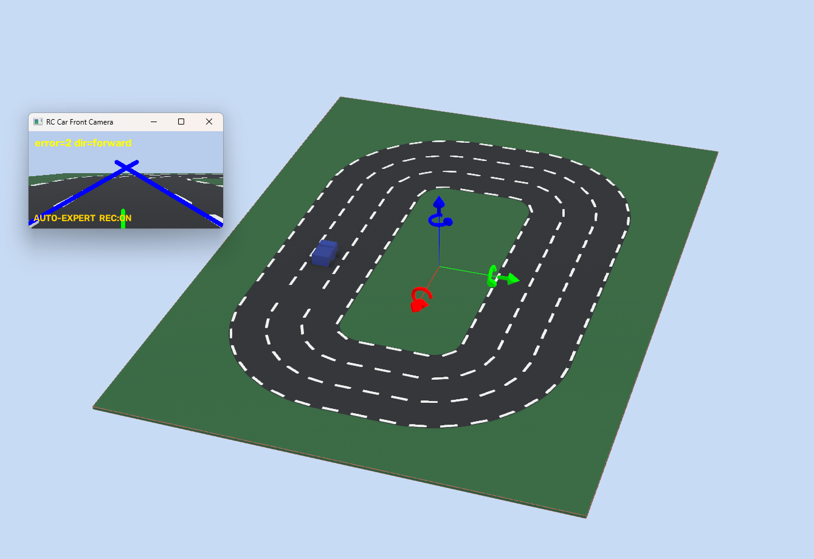

# 자율주행

| 구동 구조 | 코드 |
| --- | --- |
| 앞바퀴 서보 조향·후륜 DC 구동 | [With Steering](With%20Steering/README.md) |
| 좌우 DC 모터의 속도 차이로 회전 | [Without Steering](Without%20Steering/README.md) |

구조별 모터 배선과 제어기가 다릅니다. 제스처는 공통 [Gesture](../Gesture/README.md)를 사용합니다.

## 가상 주행 데이터셋

실물 반복 시험을 보완하기 위해 두 차량 구조에 맞춰 가상 카메라 영상과 교사 정답을 수집했습니다.

| Webots · 사륜 좌우 출력 | Unity · 앞바퀴 조향 |
| --- | --- |
|  |  |
| [Webots 데이터·학습 기록](../docs/webots-training.md) | [Unity 코드·데이터·실행 안내](With%20Steering/dataset/UnityDriving/README.md) |

## Unity 실행 중 캡처

아래는 2026-11-11 Unity를 다시 실행해 **학습 모델이 주행하는 동안** 렌더링한 실제 장면입니다.
주행 상태의 Unity 가상 카메라 출력을 이미지로 저장했습니다.
시뮬레이션 시간·차량 위치는 각 이미지 폴더의 `capture.json`에 기록합니다.
이번 실행도 1차선 출발에서 두 바퀴를 완료했으며 [실행 결과](With%20Steering/dataset/UnityDriving/Diagnostics/runtime_20261111/run_result.json)에 모델 해시와 함께 보관했습니다.

| 주행 장면 A · 시뮬레이션 약 6초 | 주행 장면 B · 약 26초 |
| --- | --- |
|  |  |

| 모델에 입력되는 실제 RGB | 같은 실행의 OpenCV 인식 표시 |
| --- | --- |
|  |  |

노랑은 경계, 하늘색은 점선 후보, 초록은 검출한 점선 연결입니다.
OpenCV는 비동기로 갱신하므로 오른쪽 화면은 왼쪽과 정확히 동일 시점의 프레임은 아닐 수 있습니다.
점선이 부족한 장면은 경로 미확인으로 표시하며, 이 선은 주행 모델의 조향 정답이 아닙니다.

## Webots 사륜 구동과 Unity 조향 데이터셋 비교

두 실험 모두 가상 카메라 영상과 교사 정답으로 **모방학습용 데이터셋**을 만들었습니다.
Webots는 사륜만, Unity는 조향만 가능한 것이 아닙니다. 아래는 **우리 코드와 데이터 생성 방식**의 비교입니다.

| 항목 | Webots · 이전 사륜 구동 실험 | Unity · 현재 앞바퀴 조향 실험 |
| --- | --- | --- |
| 차량 구성 | 회전 모터 4개, 좌우 출력 차이로 회전 | 앞바퀴 조향·후륜 구동을 운동학 자전거 모델로 계산 |
| 교사·정답 | 가상 위치·경로 기반 좌우 PWM 2개 | 가상 위치·경로 기반 바퀴 조향각·목표 속도 |
| 보관 데이터 | 17개 run에서 선별한 9,000장, 차선별 3,000장 | 최초 489장 → 현재 시야·위치·방향 변형 2,377장 |
| 입력·학습 | 회색조 32×18 픽셀, 릿지 회귀 | RGB 색 분포 12×8×3, MLP |
| 전처리·증강 | 회색조·극성 정규화, 좌우/노면 반전 | 카메라 재렌더링·위치/방향 변형, 색 분포 정규화·좌우 반전 |
| 데이터 생성의 장점 | 모터·카메라 API와 물리 노드로 구동과 수집을 연결. 마찰·접촉·질량 조건을 넣은 주행 실험으로 확장하기 좋음 | CAD 바퀴·차체 크기·카메라 시야를 현재 로봇에 맞춰 조절. 같은 기록 자세를 새 카메라 위치에서 재렌더링하고 새 조향 정답을 붙일 수 있음 |
| 데이터 생성의 단점 | 좌우 PWM 정답을 조향 차량에 바로 쓸 수 없음. 질량·마찰·모터 설정을 실물과 맞추지 않으면 움직임도 달라짐 | 현재 운동학 구현에는 타이어 미끄러짐·모터 토크·하중·배터리 편차가 없음. 카메라 시야가 좋아 보여도 실제 차량 동작을 검증한 것은 아님 |
| 영상 조건의 한계 | 노면 반전 증강이 실제 빛 반사·구김을 대신하지 못함 | 현재 단순 재질·조명 변형이 실제 반사·노출·블러를 충분히 재현하지 못함 |
| 평가에서 주의할 점 | 기존 차선별 무작위 분할은 같은 run의 인접 프레임이 양쪽에 들어갈 수 있음. 최종 주행은 영상 보정을 결합한 구성 | 시드·차선별 분할로 같은 원본 변형을 묶었지만 원본 시나리오는 3개뿐. 새 트랙·실물 평가는 별도 필요 |

**지금 목적에는 Unity를 사용합니다.** 조향장치가 있는 현재 로봇의 시야와 조향 정답을 맞추고 데이터 생성 과정을 확인하기 위한 선택입니다.
좌우 모터 출력·접촉을 포함한 이전 차량 실험은 Webots 기록이 참고 자료입니다.
실제 속도·조향·마찰을 보정하지 않은 상태에서 어느 쪽이 실물 성능이 더 좋다고 결론 내릴 수는 없습니다.
수집 FPS·생성 속도를 같은 PC·해상도·장면으로 비교한 벤치마크도 아직 없습니다.
두 데이터셋은 출력의 의미와 차량 크기가 다르므로 그대로 합쳐 한 모델에 넣지 않습니다.

근거: [Webots 데이터·학습·평가 기록](../docs/webots-training.md),
[Webots 4개 모터·Physics 정의](Without%20Steering/simulation/protos/BlueRCCar.proto),
[Unity 차량 이동 모델](With%20Steering/dataset/UnityDriving/Assets/Scripts/RobotVehicle.cs), [재렌더링 코드](With%20Steering/dataset/UnityDriving/Assets/Scripts/DrivingLabData.cs).
엔진 기능 참고: [Webots Physics](https://cyberbotics.com/doc/reference/physics),
[Unity Render Texture](https://docs.unity3d.com/2022.3/Documentation/Manual/class-RenderTexture.html).
