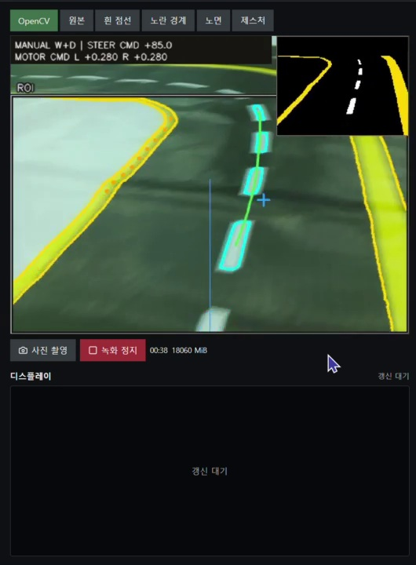
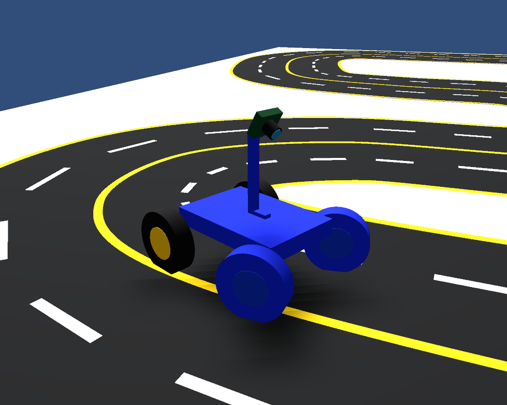
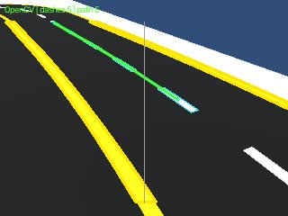

# 서보 조향 주행

[프로젝트](../../README.md) · [제스처](../../Gesture/README.md) · [DC 모터 주행](../Without%20Steering/README.md)

앞바퀴 서보와 후륜 DC 모터 두 채널을 사용하는 차량입니다.
`Auto Driving 20261018` 이후 PC 작업의 차선 인식, 수동·자율 제어,
제스처·GIF 표시와 횡단보도 연동을 모았습니다.

| 파일 | 역할 |
| --- | --- |
| `track_web.py` | Flask 진입점·카메라와 기능 연결 |
| `camera_source.py`, `track_vision.py`, `lane_path.py` | 영상 입력·차선 검출·경로 구성 |
| `manual_drive.py`, `autonomous.py` | 수동 입력·GPIO·경로 추종 |
| `gesture_adapter.py` | 공통 `Gesture/worker.py` 연결 |
| `crosswalk.py`, `interaction.py` | 횡단보도 관측과 선택적인 제스처 대기 |
| `media_capture.py`, `static/`, `templates/` | 촬영·녹화·웹 화면·GIF |
| `compare_vision.py`, `hough_vision.py`, `replay_path.py` | 오프라인 분석 |
| `experiments/paper_track/` | 이전 트랙 코드와 팀원 모터 보정본을 합친 한 벌 |
| `experiments/hardware/`, `history/` | 단품 실험·이전 시험·출처 기록 |

## 기술을 선택한 이유와 인식 과정

**OpenCV**로 HSV 노란 경계와 검은 노면을 분리한 뒤, 노면 안의 흰 표시를 색·국소 대비·윤곽 형태로 고릅니다.
**NumPy**로 점선 중심의 배열과 경로 곡선을 계산하고 노란 경계·근거리 노면으로 커브 관측을 확인합니다.
**P제어와 방향 보정**으로 위치·방향 오차를 서보 목표각에 반영하며, **GPIO Zero·lgpio**가 DC 모터·서보 출력으로 연결합니다.
**Flask**는 이 과정의 영상·결과·설정·조작 요청을 웹 화면으로 연결합니다.



위 사진은 수동 주행 중 기록한 인식 결과입니다. 초록선은 경로이며 청록색 윤곽 하나하나가 확정 경로라는 뜻은 아닙니다.
기본 경로 추출과 비교 실험용 Canny·Hough는 구분합니다.

[영상 단계·경로 오차·커브 판단·제어 연결 상세](../../docs/technical-guide.md#1-도로를-어떻게-구분하나요) ·
[도로 인식 영상](https://pedestrian-gesture-deck.pages.dev/media/driving-03.mp4)

## 조향장치 주행 데이터셋

[Unity 주행 데이터셋 · 코드·모델·검증 기록](dataset/UnityDriving/README.md)

현재 카메라 조건의 합성 영상 2,377장과 원본 Unity 수집 489장, 학습·시뮬레이터 코드를 함께 정리했습니다.
실물 주행 코드와 분리한 가상 실험이며 OpenCV는 인식 표시, 학습 MLP는 조향·속도 예측을 담당합니다.

| Unity 학습 모델 주행 중 | 차량 카메라·OpenCV 표시 |
| --- | --- |
|  |  |

2026-11-11 실제 Unity 주행 실행에서 저장한 가상 카메라 출력입니다.
이전 Webots는 사륜 좌우 모터 출력, 현재 Unity는 앞바퀴 조향각·목표 속도를 정답으로 수집합니다.
[실행 사진·Webots와 Unity의 데이터셋 생성 장단점 비교](dataset/UnityDriving/README.md#webots-사륜-구동과-unity-조향-데이터셋-비교)를 함께 정리했습니다.

## 환경과 실행 방법

Pi의 저장소 루트에서 Python 3.11 환경을 만듭니다.

```bash
cd "Auto Driving/With Steering"
uv venv --python 3.11 .venv
uv pip install --python .venv/bin/python -r requirements-gesture-pi311.txt
./.venv/bin/python -B track_web.py --gesture --fps 30 --preview-fps 30 --analysis-max-side 544 --port 5001
```

위 명령은 영상·인식 확인용입니다. OS의 `rpicam-vid` 또는 호환 Picamera2가 필요합니다.
배선을 확인한 차량에서 전체 제어 패널을 켜는 명령입니다.

```bash
./.venv/bin/python -B track_web.py \
  --manual --motor-wiring-confirmed --autonomous --gesture --lap-mode \
  --initial-speed 0.28 --pilot-speed 0.27 \
  --fps 30 --preview-fps 30 --analysis-max-side 544 --port 5001
```

접속은 `http://<파이 IP>:5001`입니다. 서버 시작은 주행을 시작하지 않습니다.
제스처 표시와 횡단보도 제스처 제어 활성화는 별도 설정입니다.
입력·전송 30FPS 설정은 도로 처리 30FPS를 보장하지 않습니다.

## 검증

```bash
./.venv/bin/python -B -m unittest discover -p 'test_*.py'
node test_pilot_ui.cjs
```

사진·영상·로그·가상환경은 Git에서 제외합니다. 이전 기록은
[history/HANDOFF_before_consolidation.md](history/HANDOFF_before_consolidation.md)에 있습니다.
그 안의 예전 경로와 실행 중 상태는 당시 기록입니다.
이번 정리는 PC에서 검사했으며 새 경로를 Pi에 배포하거나 실제 주행하지 않았습니다.
