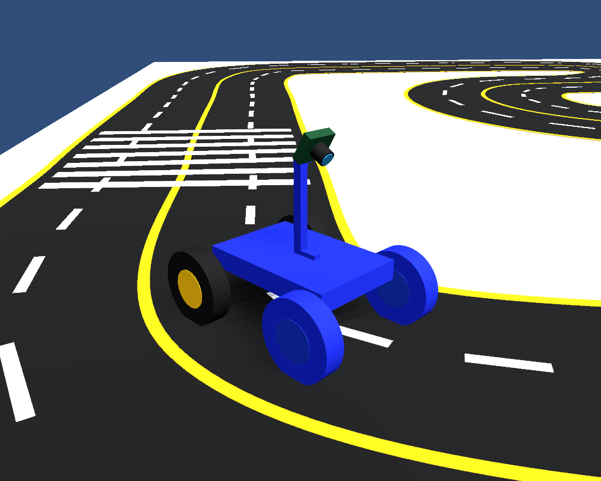
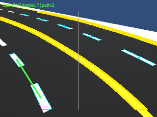

# 조향장치 차량 · Unity 주행 데이터셋

[조향장치 주행](../../README.md)

사진과 CAD 치수를 참고한 Unity 트랙·로봇에서 만든 **합성 주행 데이터셋**입니다.
실물 로봇 데이터와 이전 Webots 데이터셋과 구분합니다.

| 구성 | 내용 |
| --- | --- |
| `Dataset/` | 최초 Unity 교사 주행 489장, 조향·위치·방향·에피소드 기록 |
| `AlignedDatasetFrontCamera/` | 현재 카메라로 다시 렌더링한 2,377장과 `labels.csv` |
| `Assets/`, `Packages/`, `ProjectSettings/` | Unity 2022.3.62f3 실행 프로젝트·로봇·트랙 |
| `Assets/Resources/VisionPolicy.json` | 카메라 영상으로 조향·속도를 예측하는 학습 모델 |
| `Tools/` | 데이터 분리·검사·MLP 학습·OpenCV 차선 표시 코드 |
| `Diagnostics/` | 학습·폐루프 시험 결과와 실제 시뮬레이터 캡처 |
| `manifest.json` | 이미지 수·라벨 연결·모델 SHA-256·실험 조건 |

## 생성·학습 방식

기존 Unity 교사 주행의 위치·방향을 재사용하고, 새 카메라 시야로 영상을 다시 생성했습니다.
좌우 ±25mm·방향 ±6° 변형 장면은 해당 위치에서 교사 조향 정답을 다시 계산했습니다.
교사는 가상 경로 좌표를 아는 pure pursuit 제어기입니다.
학습은 원본 시드·차선 그룹으로 나눠 **2,102장 + 좌우 반전 = 4,204개 예시**, 검증은 275장입니다.
같은 원본의 변형 장면은 같은 분할에 포함합니다.

NumPy MLP(288→64→32→2)가 영상의 검정·흰색·노랑 분포를 읽어 조향각·목표 속도를 예측합니다.
실행 중 조향은 저장 경로 재생이나 교사 좌표 보정 없이 카메라 입력으로 결정합니다.
OpenCV는 GaussianBlur·HSV·윤곽 검출로 경계·점선·추적 경로를 **표시**하며, 현재 조향 제어기는 아닙니다.

## 현재 카메라·검증

- 광학 중심: 지면 높이 15.5cm, 차체 중앙보다 앞쪽 2cm, 아래로 30°, 수직 화각 48°.
- 지지대를 렌즈 뒤로 옮겨 중앙 시야 확보. 모델과 카메라 조건이 다르면 출발하지 않음.
- 1차선 출발 2바퀴 80.62초 / 2차선 출발 2바퀴 92.23초, 교사 조향 전환 0회.
- 검증 영상 평균 조향 오차 약 0.98°. Python·Unity의 동일 이미지 특징 차이 0.
- 같은 가상 트랙의 두 출발 조건에서 확인한 결과이며 실물·새 트랙 성능은 미검증.
- 트랙 일부 치수는 사진 기반 추정, 차량은 타이어 미끄러짐 없는 운동학 모델.
- 횡단보도 줄무늬는 트랙에 있으나 이 실험은 제스처·보행자 정차 제어를 포함하지 않음.




## 실행

1. 이 `UnityDriving` 폴더를 Unity Hub에서 **2022.3.62f3 프로젝트**로 엽니다.
2. PC Python에 `python -m pip install -r requirements.txt`를 실행합니다.
3. `Assets/Scenes/DrivingLab.unity`를 열고 Play. 씬이 없으면 `Capstone → Build or reset driving lab`.
4. P: 모델 주행 / C: OpenCV 카메라 창 / H: 상태창 / Space·Esc: 정지.
   W/S·A/D: 수동, T: 데이터 수집용 교사, R: 기록.

OpenCV 실행 Python은 `Assets/Settings/DrivingConfig.asset`의 `openCvPython`에 설정합니다.
기본값 `python`이 안 잡히면 설치된 Python 실행 파일의 절대 경로를 입력합니다.

재학습은 이 폴더에서 실행합니다.

```powershell
python Tools/train_vision_policy.py --data AlignedDatasetFrontCamera --epochs 400
```

원본 교사 수집 때 카메라는 앞쪽 65mm였으며 현재 +20mm 영상과 혼동하면 안 됩니다.
이전 뒤쪽 카메라의 중간 렌더링·캐시·Unity Library는 제외하고 현재 데이터와 원본 기록을 보관했습니다.
Unity·Python 코드는 PC 시뮬레이션 전용이며 Raspberry Pi GPIO를 제어하지 않습니다.
