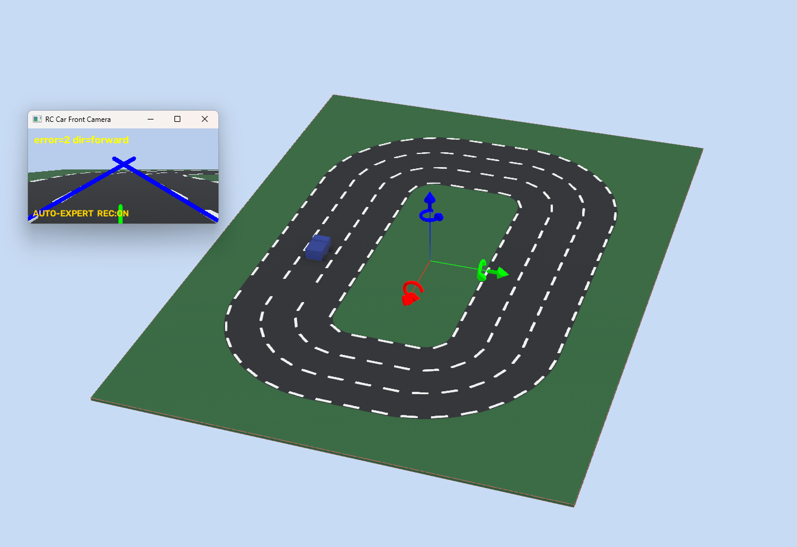

# Webots 주행 데이터 생성·모델 학습 실험

[프로젝트](../../../README.md) · [서보 없는 주행](../README.md) · [사진과 함께 보는 개발 과정](../../../docs/webots-training.md)

실물 없이 반복 실험하기 위해 가상 트랙·차량·카메라를 만들고,
교사 제어기의 좌우 PWM을 정답으로 **영상 기반 릿지 회귀 모델**을 학습했던 작업입니다.
현재 서보 차량의 기본 주행과는 별도 실험이며 데이터·모델·평가 기록을 보존합니다.

[Unity 조향 차량 실행 사진·데이터셋 생성 장단점 비교](../../With%20Steering/dataset/UnityDriving/README.md#webots-사륜-구동과-unity-조향-데이터셋-비교)에서는
이전 사륜 좌우 출력 방식과 현재 앞바퀴 조향 방식의 정답·물리 모델·데이터 구성 차이를 설명합니다.



2026-11-03 기존 월드를 다시 열어 사용자가 캡처한 `AUTO-EXPERT REC:ON` 화면입니다.
교사 주행·기록 모드이며, 학습 모델의 새 성능 평가 화면은 아닙니다.

## 보존된 자료

| 폴더 | 내용 |
| --- | --- |
| `worlds/`, `protos/` | 타원·점선 직사각형·반전 노면 월드, 차선별 수집 월드, 가상 4륜 차량 |
| `controllers/`, `simulation/` | 교사·영상·학습 제어기, 가상 모터 연결, 영상 전처리 |
| `dataset_v2/` | 차선별 3,000장씩 총 9,000장, 정답·원시 출처 manifest, 선별 통계 |
| `training/` | 데이터 선별, 증강, 릿지 회귀·주행 가능성 학습, 폐루프 평가 |
| `models/` | `steering_v1`, `steering_v2`, `driveability_v1` NPZ와 검증 지표 |
| `reports/` | 과거 일반·반전 노면 주행 평가 JSON |
| `hardware/` | 이전 4모터 로봇용 어댑터·배포 도구. 현재 서보 로봇과 구분 |
| `history/`, `HANDOFF.md`, `RASPBERRY_PI_DEPLOY.md` | 당시 인계·환경·배선·실행 기록 |

`dataset/runs/` 원시 실행은 Git에서 제외됩니다. 기존 PC 백업의 원시 자료는 보존합니다.
과거 문서의 `Dataset Project`는 현재 이 폴더, `Lee`의 비제스처 코드는 현재 `../legacy_rover`입니다.
원래 README는 [history/README_before_webots_documentation.md](history/README_before_webots_documentation.md)에 보존했습니다.

## 수집 → 학습 → 평가

1. Webots에서 `worlds/collect_rectangle_lane_1.wbt`~`lane_3.wbt`를 각각 열어 교사 주행을 기록합니다.
2. 이미지를 차선별 선별하고 교사 정답·복구 사례를 `dataset_v2`에 모읍니다.
3. 회색조·노면 극성 정규화·32×18 축소·좌우 및 노면 반전 증강 후 릿지 회귀를 학습합니다.
4. 예측 PWM 오차와 모델이 직접 운전하는 폐루프 주행을 나누어 평가합니다.

[상세 설명](../../../docs/webots-training.md)에 입력·정답 예시, 학습 수량, 실패 사례와 개선, 지표의 해석 범위를 적었습니다.

## 실행 안내

저장소 루트에서 시작합니다. 아래 명령은 실제 로봇을 제어하지 않습니다.

```powershell
cd "Auto Driving/Without Steering/simulation"
python -m pip install numpy opencv-python
python -B -m unittest discover -s tests -v
```

Webots R2025a에서 `worlds/collect_rectangle_lane_2.wbt`를 열 수 있습니다.
`controllers/rc_car_controller/runtime.ini`는 당시 PC의 Python 3.9 절대 경로를 가리킵니다.
새 PC에서는 OpenCV·NumPy를 설치한 Python 경로에 맞춰야 합니다.
3D 화면에 포커스를 둔 상태에서 `M`은 수동/자동 전환, `V`는 교사/영상/학습 모델 전환, `R`은 기록 전환입니다.
재생 시 기본 교사·기록 모드가 켜질 수 있어 단순 확인 후에는 기록·실행을 멈춥니다.

선별 데이터만으로 주행 모델을 다시 학습하려면 다음을 실행합니다.
기존 모델·지표 파일이 갱신되므로 재현 실험은 별도 작업 복사본에서 진행하는 편이 좋습니다.

```powershell
python -B training/train_steering_v2.py
```

아래 명령은 **원시 `dataset/runs/`가 있을 때만** 의미가 있습니다. 저장소만 복제하면 일부 원시 기록이 없습니다.

```powershell
python -B training/build_dataset_v2.py --dry-run
python -B training/train_driveability.py
python -B training/evaluate_drive_run.py run_20260901_172142 run_20260901_172316
```

이번 문서 정리에서는 기존 모델을 재학습하거나 과거 평가 수치를 새로 생성하지 않았습니다.
