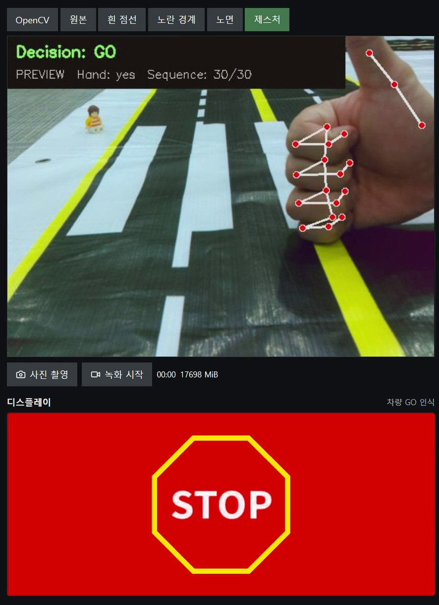

# 제스처 인식

[프로젝트](../README.md) · [서보 주행](../Auto%20Driving/With%20Steering/README.md)

Lee의 MediaPipe·KNN 모듈을 바탕으로 PC 웹캠 실험과 Flask 연결 작업을 모았습니다.
인식 코드와 모델은 이 폴더에 한 번만 보관하며 주행 화면도 같은 모듈을 사용합니다.

| 파일 | 역할 |
| --- | --- |
| `gesture_recognition_module.py`, `hand_utils.py` | 손 관절 21개, 좌표 정규화, 연속 30프레임 특징과 KNN |
| `models/gesture_knn_model.npz` | Lee에서 이어받은 256개 손동작 시퀀스 특징·라벨 |
| `worker.py` | 최신 프레임 처리·결과 신선도·표시와 제어 판단 분리 |
| `run_webcam.py`, `camera_guard.py` | PC 웹캠 실행·중복 실행 방지 |
| `person_detection.py` | YOLOv8n-seg 사람 윤곽 검출 |
| `cnn_compare_module.py`, `models/*.pt` | 선택적인 CNN 분류 비교·로그 |
| `experiments/collection/`, `history/` | 이전 수집·학습 실험과 출처·검증 기록 |

## 기술을 선택한 이유와 인식 과정

**MediaPipe**는 손 관절 21개의 좌표를 찾고, **NumPy**는 좌표 정규화와 배열·거리 계산에 사용합니다.
**KNN**은 정규화한 최근 30프레임(1,890차원)을 저장 예시 256개와 비교해 가까운 3개로 GO·STOP을 분류합니다.
손목 위치를 빼고 손 크기로 나누어 위치·크기 변화의 영향을 줄이며, 충분한 손 검출과 특징 거리 조건이 안 맞으면 unknown을 반환합니다.
즉 KNN과 NumPy는 대체 관계가 아니라 분류 방법과 계산 도구입니다.



차량 GO에 **빨강**, 차량 STOP에 **초록**을 표시하여 보행자에게 응답합니다.
이 사진은 PREVIEW 인식 시연이며, 모터 출발은 별도 연동 설정·신선한 판정·경로 조건에 따릅니다.

[단계별 계산·모델·오인 방지·현재 한계](../docs/technical-guide.md#3-손동작은-어떻게-gostop이-되나요) ·
[시연 영상](https://pedestrian-gesture-deck.pages.dev/media/gesture-present-merged-20261022.mp4)

## PC 실행 방법

저장소 루트에서 PowerShell로 실행합니다.

```powershell
cd Gesture
uv venv --python 3.11 .venv
uv pip install --python .venv\Scripts\python.exe --index-url https://download.pytorch.org/whl/cpu torch==2.8.0 torchvision==0.23.0
uv pip install --python .venv\Scripts\python.exe --excludes opencv-excludes.txt -r requirements.txt
& .venv\Scripts\python.exe run_webcam.py --gesture-only
```

사람 윤곽도 표시하려면 `--gesture-only`를 생략합니다. YOLO 가중치는 최초 실행 때 다운로드됩니다.
`q` 또는 Esc로 종료합니다. `Dist`는 특징 거리이며 확률이나 물리적 거리가 아닙니다.

## Flask와 검증

주행의 `gesture_adapter.py`는 이 폴더의 `worker.py`를 불러오는 연결 파일입니다.
화면에 잠시 유지된 GO 라벨은 새로운 출발 허가로 사용하지 않습니다.

```powershell
& .venv\Scripts\python.exe -B -m unittest discover -p 'test_*.py'
```

과거 수집 실험에는 손과 몸 자세를 함께 쓰는 코드도 있어 보존된 손 전용 모델과 입력 차원을
맞춰야 합니다. 사람 검출과 손동작은 아직 개별 사람에게 연결된 관측이 아닙니다.
