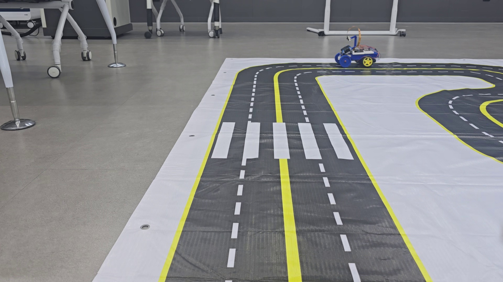
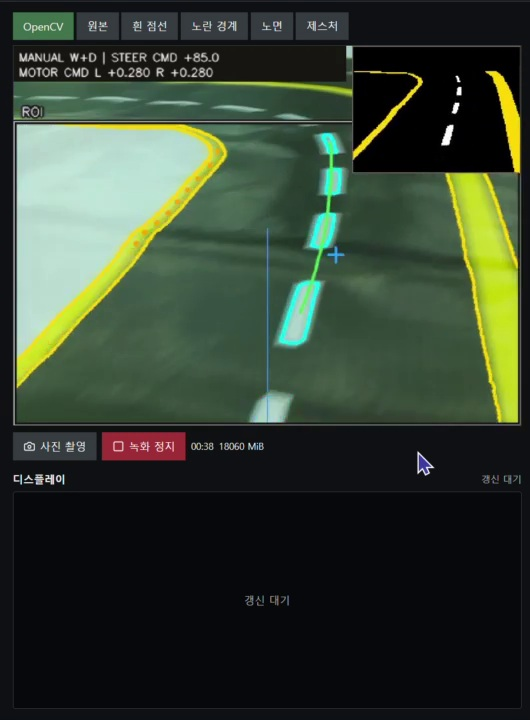
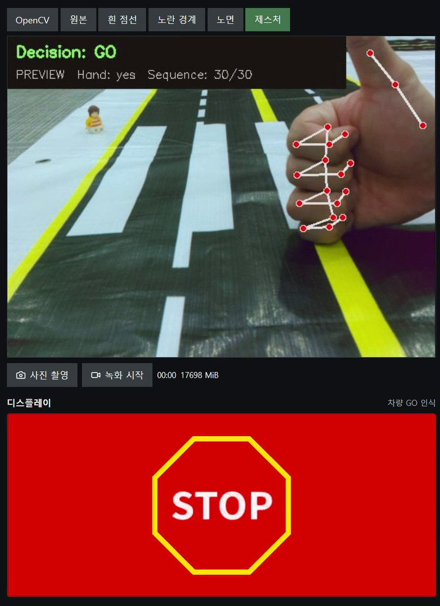

# 보행자와 소통하는 자율주행 시스템

Raspberry Pi 모형 차량의 차선 추종과 손동작 인식을 다룬 캡스톤 팀 프로젝트입니다.
주행은 조향장치 유무에 따라 구분하고, 제스처 인식은 별도 모듈로 관리합니다.



## 프로젝트 구성

| 영역 | 주요 내용 | 코드와 개발 기록 |
| --- | --- | --- |
| 조향장치 없는 주행 | 좌우 DC 모터의 속도 차이로 회전, OpenCV 차선 추종과 학습 모델 실험 | [살펴보기](docs/driving-without-servo.md) |
| 조향장치 있는 주행 | 앞바퀴 서보 조향과 후륜 구동, 경로 추종과 Flask 수동·자율 제어 | [살펴보기](docs/driving-with-servo.md) |
| 제스처 인식 | MediaPipe 손 관절 추출, NumPy 특징 처리, KNN GO·STOP 분류 | [살펴보기](docs/gesture-recognition.md) |

## 사용 기술

| 기술 | 이 프로젝트에서 사용한 이유 | 실제 처리 |
| --- | --- | --- |
| Python | 영상·인식·하드웨어·웹 모듈을 같은 실행 환경에서 연결 | Pi와 PC의 실행 코드, 작업 스레드, 데이터·로그 처리 |
| OpenCV | 트랙의 색과 모양을 이용해 차선 후보를 빠르게 추출 | HSV 노란 경계 분리, 흰 점선 윤곽·크기 검사, 횡단보도 줄무늬 분석 |
| NumPy | 이미지와 손 좌표를 배열로 계산 | 영상 마스크, 손 좌표 정규화, KNN 거리 계산, 경로 곡선 맞춤 |
| MediaPipe | 영상에서 손의 위치를 21개 관절 좌표로 표현 | 한 손의 x·y·z 좌표 추출과 추적. GO·STOP 판정은 KNN이 담당 |
| KNN | 저장한 동작 예시와 현재 손동작을 비교해 분류 | 기본 30프레임 특징을 가장 가까운 예시 3개와 비교하고, 너무 다르면 unknown 처리 |
| GPIO Zero · lgpio | 영상의 판단을 실제 모터 제어 출력으로 연결 | GPIO Zero의 Motor·AngularServo와 lgpio 핀 백엔드로 DC 모터·서보 제어 |
| P제어 · 방향 보정 | 경로에서 벗어난 정도와 커브 방향을 조향에 반영 | 서보 버전은 위치 오차와 방향 오차를 합산, 구형 버전은 좌우 모터 출력 차이로 회전 |
| Flask · HTML/CSS · JavaScript | 로봇 시야·인식 결과를 보면서 실험하고 조작 | 영상 스트리밍, 수동·자율 제어 패널, 촬영·녹화, 제스처 GIF 표시 |

YOLOv8n-seg·Ultralytics·PyTorch는 **PC 사람 윤곽 검출**, CNN은 **제스처 비교 실험**,
Webots는 **별도 시뮬레이션·데이터 생성**에 사용했습니다. 모두 기본 Pi 주행에 항상 실행되는 기술은 아닙니다.

## 실제로 어떻게 인식하나요?

**도로:** 카메라 → 노란 경계·검은 노면 분리 → 흰 점선 후보 추출 → 점선과 경계로 경로 구성 → 위치·방향 오차 → 조향·속도 출력.

**제스처:** 카메라 → MediaPipe 손 관절 21개 → 손목 기준 좌표 정규화 → 연속 30프레임 특징 → KNN → GO·STOP·unknown → 디스플레이 응답.

| 도로 인식·경로 표시 | 제스처 인식·디스플레이 응답 |
| --- | --- |
|  |  |
| 청록색은 흰 점선 후보, 초록색은 경로입니다. **수동 주행 중 기록한 인식 화면**이며 자율 완주 증빙은 아닙니다. | 차량 GO 요청에 빨간 보행자 STOP을 표시합니다. 위 화면은 PREVIEW 인식 시연이며 실제 출발 여부는 별도 제어 상태에 따릅니다. |

[사진으로 보는 기술 설명](docs/technical-guide.md)에서 처리 단계·계산 방법·코드 위치·한계를 설명합니다.
사진은 [발표 사이트](https://pedestrian-gesture-deck.pages.dev/showcase#1)의 실제 시연 자료에서 가져왔습니다.

## 개발 과정

DC 모터 속도 차이를 이용한 주행 실험에서 시작해 서보 조향 구조로 확장했습니다.
차선 검출, 모터 출력 보정, 커브 경로 추종을 실험하고, 손동작 인식 모듈을 별도로 정리했습니다.
이 저장소에는 각 시기의 코드와 설정·검증 기록을 함께 보관합니다.

[발표 및 시연 자료](https://pedestrian-gesture-deck.pages.dev/showcase) · [전체 폴더 안내](docs/repository-map.md)

## 코드 버전

```text
Gesture/                       제스처 공통 모듈·모델·PC 웹캠
Auto Driving/
  With Steering/               서보 조향 차량과 Flask 통합
  Without Steering/            좌우 DC 모터 주행·이전 로봇·시뮬레이션
docs/                          구조·변경 이력·출처
```

후속 주행·제스처·GIF 연결 코드까지 포함해 정리했습니다.
영역별 README에 실행 방법이 있으며, 이전 파일 위치와 중복 통합 내역은
[폴더 안내](docs/repository-map.md)에서 확인할 수 있습니다.
