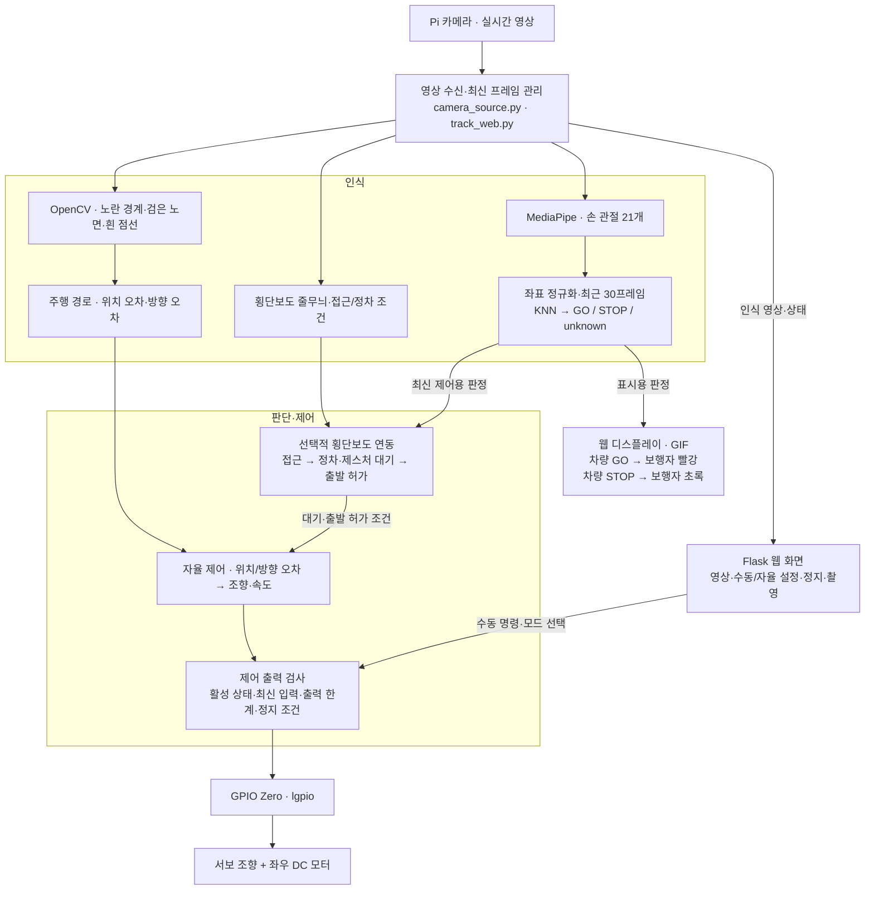
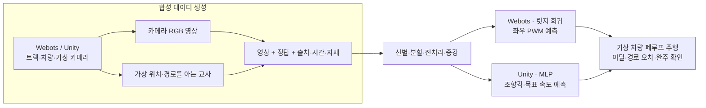

# 보행자와 소통하는 자율주행 시스템

Raspberry Pi 모형 차량의 차선 추종과 손동작 인식을 다룬 캡스톤 팀 프로젝트입니다.
주행은 조향장치 유무에 따라 구분하고, 제스처 인식은 별도 모듈로 관리합니다.

## 프로젝트 구성

| 영역 | 주요 내용 | 코드와 개발 기록 |
| --- | --- | --- |
| 조향장치 없는 주행 | 좌우 DC 모터의 속도 차이로 회전, OpenCV 차선 추종과 학습 모델 실험 | [살펴보기](docs/driving-without-servo.md) |
| 조향장치 있는 주행 | 앞바퀴 서보 조향과 후륜 구동, 경로 추종과 Flask 수동·자율 제어 | [살펴보기](docs/driving-with-servo.md) |
| 제스처 인식 | MediaPipe 손 관절 추출, NumPy 특징 처리, KNN GO·STOP 분류 | [살펴보기](docs/gesture-recognition.md) |
| 이전 Webots 학습 실험 | 가상 교사 주행에서 데이터 9,000장을 선별하고 영상→좌우 PWM 모델 학습·평가 | [사진과 개발 과정](docs/webots-training.md) |
| Unity 조향 학습 실험 | 현재 로봇·카메라 기준 합성 영상 2,377장, 영상→조향각·속도 모델 | [실행 사진·두 실험 비교](Auto%20Driving/README.md) |

## 시스템 아키텍처

시스템은 **실물 로봇의 인식·주행·응답**과 **가상 환경의 데이터 생성·학습**으로 나뉩니다.
실물의 기본 주행은 OpenCV 경로 추종이며, Unity의 학습 주행과 구분합니다.

### 1. 실물 로봇: 보고 → 판단하고 → 움직이고 → 응답하기



1. **영상 입력:** Pi 카메라 프레임을 도로·횡단보도·손동작 인식에 전달합니다.
2. **도로 추종:** 색·윤곽에서 경로를 만들고 위치·방향 오차를 조향과 속도에 반영합니다.
3. **손동작 인식:** MediaPipe가 좌표를 찾고, KNN이 저장 예시와 비교합니다. 손 미검출·조건 부족은 unknown으로 처리합니다.
4. **주행 판단:** 횡단보도 연동은 선택 기능입니다. 활성화하면 정차·대기 상태와 최신 제스처·경로 조건을 함께 확인합니다. 화면의 GO 글자만으로 출발하지 않습니다.
5. **출력·응답:** 모터 명령과 보행자용 표시를 나눕니다. GIF는 차량의 요청 해석을 보여주며 실제 바퀴 동작을 측정한 값은 아닙니다.

| 모듈 | 입력 → 출력 | 코드 |
| --- | --- | --- |
| 영상·웹 연결 | 카메라·브라우저 요청 → 최신 프레임·상태·영상 스트림 | `camera_source.py`, `track_web.py` |
| 도로·경로 | 영상 → 색 마스크·점선 후보·경로·오차 | `track_vision.py`, `lane_path.py`, `boundary_guidance.py`, `turn_recovery.py` |
| 횡단보도·주행 판단 | 횡단보도·경로·제스처 → 대기/주행 상태·목표 명령 | `crosswalk.py`, `interaction.py`, `autonomous.py` |
| 제스처 공통 모듈 | 영상 → 손 좌표·시퀀스 특징·판정 | `Gesture/gesture_recognition_module.py`, `hand_utils.py`, `worker.py` |
| 하드웨어·기록 | 제한된 명령 → GPIO 출력 / 영상·로그 저장 | `manual_drive.py`, `media_capture.py` |

주행 파일은 [`Auto Driving/With Steering`](Auto%20Driving/With%20Steering/README.md)에,
공통 손동작 코드는 [`Gesture`](Gesture/README.md)에 있습니다. `gesture_adapter.py`가 두 영역을 연결합니다.
PC의 YOLO 사람 윤곽 검출은 선택 실험이며, 위 Pi 기본 파이프라인에 항상 포함되지는 않습니다.
현재 사람 검출과 손동작을 특정 보행자 한 명에게 연결하는 기능은 완성되지 않았습니다.

### 2. 가상 환경: 데이터 생성 → 학습 → 영상 기반 주행 평가



교사의 가상 위치·경로는 **데이터 정답 생성**에 사용합니다.
Unity 모델은 실행 시 원본 카메라 영상에서 예측하며, OpenCV 경계·점선 연결은 별도 확인 화면입니다.
Webots 최종 평가에는 영상 오차 보정이 결합돼 있어 Unity의 모델 단독 주행 결과와 직접 성능 비교하지 않습니다.
가상 데이터와 모델의 저장 위치·실험 조건·장단점은 아래 비교와 [Auto Driving README](Auto%20Driving/README.md)에 정리했습니다.

## 사용 기술

| 기술 | 이 프로젝트에서 사용한 이유 | 실제 처리 |
| --- | --- | --- |
| Python | 영상·인식·하드웨어·웹 모듈을 같은 실행 환경에서 연결 | Pi와 PC의 실행 코드, 작업 스레드, 데이터·로그 처리 |
| OpenCV | 트랙의 색과 모양을 이용해 차선 후보를 빠르게 추출 | HSV 노란 경계 분리, 흰 점선 윤곽·크기 검사, 횡단보도 줄무늬 분석 |
| NumPy | 이미지와 손 좌표를 배열로 계산 | 영상 마스크, 손 좌표 정규화, KNN 거리 계산, 경로 곡선 맞춤 |
| MediaPipe | 영상에서 손의 위치를 21개 관절 좌표로 표현 | 한 손의 x·y·z 좌표 추출과 추적. GO·STOP 판정은 KNN이 담당 |
| KNN | 저장한 동작 예시와 현재 손동작을 비교해 분류 | 기본 30프레임 특징을 가장 가까운 예시 3개와 비교하고, 너무 다르면 unknown 처리 |
| GPIO Zero · lgpio | 영상의 판단을 실제 모터 제어 출력으로 연결 | GPIO Zero의 Motor·AngularServo와 lgpio 핀 백엔드로 DC 모터·서보 제어 |
| P제어 · 방향 보정 | 경로에서 벗어난 정도와 커브 방향을 조향에 반영 | 서보 버전은 위치 오차와 방향 오차를 합산, 구형 버전은 좌우 모터 출력 차이로 회전 |
| Flask · HTML/CSS · JavaScript | 로봇 시야·인식 결과를 보면서 실험하고 조작 | 영상 스트리밍, 수동·자율 제어 패널, 촬영·녹화, 제스처 GIF 표시 |

YOLOv8n-seg·Ultralytics·PyTorch는 **PC 사람 윤곽 검출**, CNN은 **제스처 비교 실험**,
Webots·Unity는 **별도 시뮬레이션·데이터 생성·학습 실험**에 사용했습니다. 모두 기본 Pi 주행에 항상 실행되는 기술은 아닙니다.

## 실제로 어떻게 인식하나요?

**도로:** 카메라 → 노란 경계·검은 노면 분리 → 흰 점선 후보 추출 → 점선과 경계로 경로 구성 → 위치·방향 오차 → 조향·속도 출력.

**제스처:** 카메라 → MediaPipe 손 관절 21개 → 손목 기준 좌표 정규화 → 연속 30프레임 특징 → KNN → GO·STOP·unknown → 디스플레이 응답.

| 도로 인식·경로 표시 | 제스처 인식·디스플레이 응답 |
| --- | --- |
|  |  |
| 청록색은 흰 점선 후보, 초록색은 경로입니다. **수동 주행 중 기록한 인식 화면**이며 자율 완주 증빙은 아닙니다. | 차량 GO 요청에 빨간 보행자 STOP을 표시합니다. 위 화면은 PREVIEW 인식 시연이며 실제 출발 여부는 별도 제어 상태에 따릅니다. |

[사진으로 보는 기술 설명](docs/technical-guide.md)에서 처리 단계·계산 방법·코드 위치·한계를 설명합니다.
사진은 [발표 사이트](https://pedestrian-gesture-deck.pages.dev/showcase#1)의 실제 시연 자료에서 가져왔습니다.

## 개발 과정

DC 모터 속도 차이를 이용한 주행 실험에서 시작해 서보 조향 구조로 확장했습니다.
차선 검출, 모터 출력 보정, 커브 경로 추종을 실험하고, 손동작 인식 모듈을 별도로 정리했습니다.
이 저장소에는 각 시기의 코드와 설정·검증 기록을 함께 보관합니다.

[발표 및 시연 자료](https://pedestrian-gesture-deck.pages.dev/showcase) · [전체 폴더 안내](docs/repository-map.md)

## Webots · Unity 주행 데이터셋 실험

실물 차량의 반복 시험을 보완하기 위해, 차량 구조에 맞춰 두 가상 환경에서 카메라 영상과 교사 정답을 수집했습니다.

| Webots · 사륜 좌우 출력 | Unity · 앞바퀴 조향 |
| --- | --- |
|  |  |
| 모터 4개의 좌우 출력 차이로 회전 | 앞바퀴 조향각·목표 속도로 이동 |
| 17개 run에서 선별한 영상 **9,000장** | 최초 기록 489장 → 현재 시야·변형 영상 **2,377장** |
| 회색조 픽셀 → 릿지 회귀 → 좌우 PWM | RGB 색 분포 → MLP → 조향각·목표 속도 |
| [데이터·학습·평가 기록](docs/webots-training.md) | [코드·데이터·학습·실행 안내](Auto%20Driving/With%20Steering/dataset/UnityDriving/README.md) |

Webots 사진은 교사 주행·수집 화면, Unity 사진은 2026-11-11 학습 모델 주행 중 가상 카메라 출력입니다.
Webots는 모터·물리 조건 실험을 연결하고, Unity는 현재 조향 차량의 크기·카메라 위치를 맞춰 같은 자세를 재렌더링하는 데 사용했습니다.
두 데이터셋은 출력 의미가 달라 그대로 합치지 않으며, 실물 적용에는 별도 보정·검증이 필요합니다.
시뮬레이션 모델은 Raspberry Pi의 기본 제어기를 자동으로 대체하지 않습니다.

**[Auto Driving에서 실행 사진·인식 화면·장단점 비교표 바로 보기](Auto%20Driving/README.md#가상-주행-데이터셋)**

## 코드 버전

```text
Gesture/                       제스처 공통 모듈·모델·PC 웹캠
Auto Driving/
  With Steering/               서보 조향 차량과 Flask 통합
  Without Steering/            좌우 DC 모터 주행·이전 로봇·시뮬레이션
docs/                          구조·변경 이력·출처
```

후속 주행·제스처·GIF 연결 코드까지 포함해 정리했습니다.
영역별 README에 실행 방법이 있으며, 이전 파일 위치와 중복 통합 내역은
[폴더 안내](docs/repository-map.md)에서 확인할 수 있습니다.
