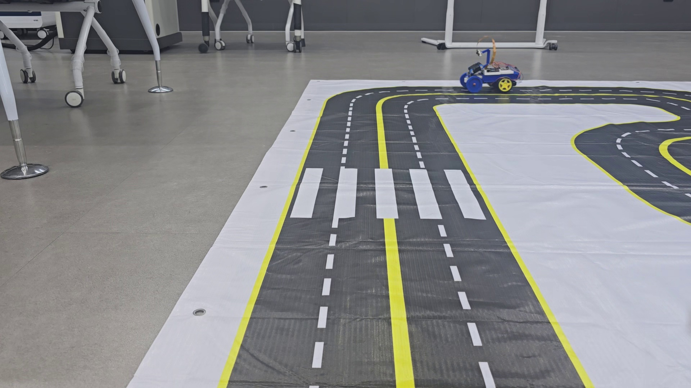

# 조향장치 있는 주행

[프로젝트 처음으로](../README.md) · [조향장치 없는 주행](driving-without-servo.md) · [제스처 인식](gesture-recognition.md)

## 구동 방식

앞바퀴는 서보와 조향 링크로 방향을 바꾸고, 후륜 DC 모터 두 채널이 차량을 추진합니다.
주행 방향을 만드는 서보 명령과 추진 출력을 나누어 제어하는 방식입니다.



## 버전 안내

| 버전 | 구분 | 시작 문서 |
| --- | --- | --- |
| `Auto Driving 20261018` | 새 검정 노면·노란 경계·흰 점선 트랙의 Python 3.11 공개 기준본 | [README](../Auto%20Driving%2020261018/README.md) |
| `Auto Driving` | 이전 트랙에서 수행한 서보 조향 주행과 수동 데이터 분석 기록 | [README](../Auto%20Driving/README.md) |
| `Auto Driving@` | 팀원이 추가 작업한 후륜 출력 보정 코드 보관본 | [README](../Auto%20Driving%40/README.md) |

`Auto Driving@`는 팀원의 별도 작업 기록입니다. 이름의 기호가 최신 버전이라는 뜻은 아닙니다.
위 버전은 트랙, 보정값, 전진 극성에 차이가 있으므로 파일을 임의로 섞어 사용하지 않습니다.

## 공개 기준본의 코드 구조

| 파일 | 역할 |
| --- | --- |
| [`track_web.py`](../Auto%20Driving%2020261018/track_web.py) | Flask 진입점, 카메라·인식·제어 화면 연결 |
| [`camera_source.py`](../Auto%20Driving%2020261018/camera_source.py) | Pi 카메라 입력 |
| [`track_vision.py`](../Auto%20Driving%2020261018/track_vision.py) | 노란 경계·흰 점선·노면 분리 |
| [`lane_path.py`](../Auto%20Driving%2020261018/lane_path.py) | 점선과 경계로 경로 구성·검증 |
| [`autonomous.py`](../Auto%20Driving%2020261018/autonomous.py) | 위치·방향 오차에 따른 조향과 추진 명령 |
| [`manual_drive.py`](../Auto%20Driving%2020261018/manual_drive.py) | GPIO 제어, 수동 입력과 출력 제한 |
| [`media_capture.py`](../Auto%20Driving%2020261018/media_capture.py) | 사진·주행 영상 저장 |

```text
카메라 -> 색상·노면 검출 -> 경로 검증 -> 조향·속도 계산 -> 서보와 DC 모터
```

## 실행과 검증 기록

환경 설치는 [기준본 README](../Auto%20Driving%2020261018/README.md),
시험 조건과 인계 내용은 [HANDOFF](../Auto%20Driving%2020261018/HANDOFF.md)에 정리되어 있습니다.
이 공개 기준본의 `gesture_reference/`는 제스처 원본·모델 보관용이며, 통합 실행 옵션을 제공하지 않습니다.
후속 작업의 GIF 화면과 통합 실행문을 이 기준본에 그대로 적용할 수는 없습니다.

모형 트랙에서 직선·커브 주행 시험을 수행한 기록이며, 저장된 자료로 중단 없는 반복 완주가 입증된 것은 아닙니다.

[모든 버전의 위치](repository-map.md)
