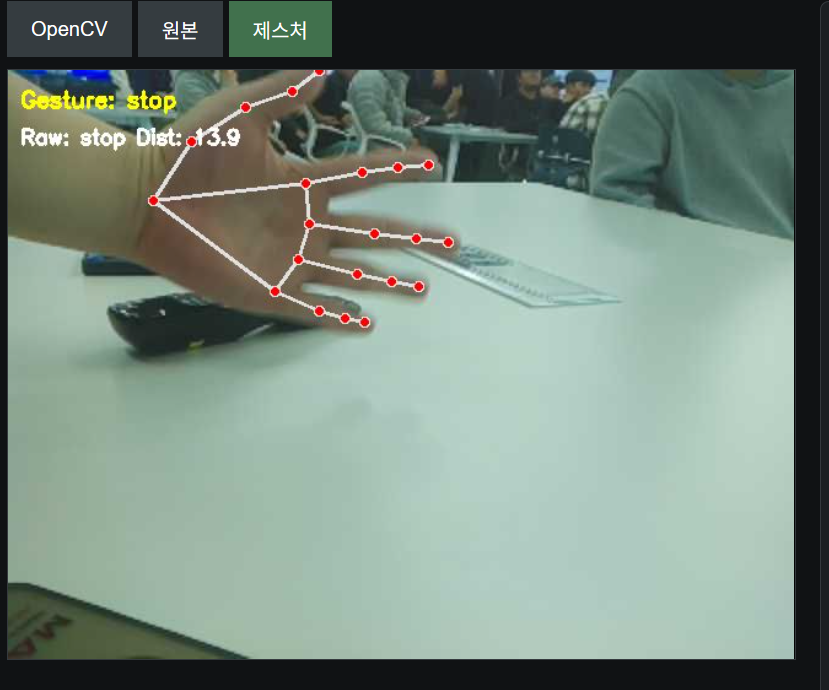

# 제스처 인식

[프로젝트 처음으로](../README.md) · [조향장치 없는 주행](driving-without-servo.md) · [서보 조향 주행](driving-with-servo.md)

MediaPipe가 추출한 손 관절 좌표를 특징으로 만들고, KNN으로 GO·STOP·unknown을 분류하는 작업입니다.
인식 결과의 화면 표시와 실제 모터 제어 연결은 구분해 관리합니다.



## 처리 과정

```text
카메라 영상 -> MediaPipe 손 관절 21개 -> 좌표 정규화
           -> 연속 프레임 특징 -> KNN 거리 비교 -> GO / STOP / unknown
```

| 기술 | 역할 |
| --- | --- |
| MediaPipe | 손 관절의 x·y·z 좌표 추출 |
| NumPy | 좌표 정규화, 특징 결합, 유클리드 거리와 다수결 계산 |
| KNN | 저장된 특징·라벨과 비교해 제스처 분류 |
| OpenCV | 입력 영상 변환, 관절 연결선과 인식 결과 표시 |

## 코드와 모델

| 위치 | 역할 |
| --- | --- |
| [`Lee/gesture`](../Lee/gesture/README.md) | 통합용 제스처 모듈, 손 좌표 보조 함수와 KNN 모델 |
| [`gesture_recognition_module.py`](../Lee/gesture/gesture_recognition_module.py) | `GestureRecognizer`, 프레임 처리와 분류 |
| [`hand_utils.py`](../Lee/gesture/hand_utils.py) | 손목 기준 정규화, 손 펼침·손바닥 방향 검사 |
| [`gesture_knn_model.npz`](../Lee/gesture/gesture_knn_model.npz) | 비교에 사용하는 특징과 라벨 |
| [`gesture`](../gesture/) | 데이터 수집, 학습, 인식 테스트 스크립트 |
| [`gesture_reference`](../Auto%20Driving%2020261018/gesture_reference/) | 10월 18일 주행 기준본에 보존한 제스처 원본·모델 |

`Lee/gesture/`에는 선택적인 CNN 비교 코드도 있습니다. 분류 비교와 로그 기록용이며,
KNN을 대체하는 주행 제어기로 설명하지 않습니다.

## 버전을 확인할 부분

각 폴더는 작성 시점과 특징 구성에 차이가 있습니다. 수집·학습 스크립트가 보존된 모델과
동일한 입력 차원을 사용하는지 확인한 뒤 연결해야 합니다.
과거 문서에는 손동작과 라벨 설명이 서로 다른 부분도 있으므로,
시연에 사용하는 동작 정의는 실제 코드·모델과 테스트 결과로 확인합니다.

포함된 KNN은 저장 예시를 비교하는 방식이며, 주행을 반복한다고 자동으로 재학습되지 않습니다.
제스처 미검출을 보행자 부재로 판단하지 않습니다.

자세한 함수 설명과 연결 방법은 [모듈 설명서](../Lee/gesture/README.md),
주행 버전별 연결 범위는 [서보 조향 안내](driving-with-servo.md)를 참고합니다.
