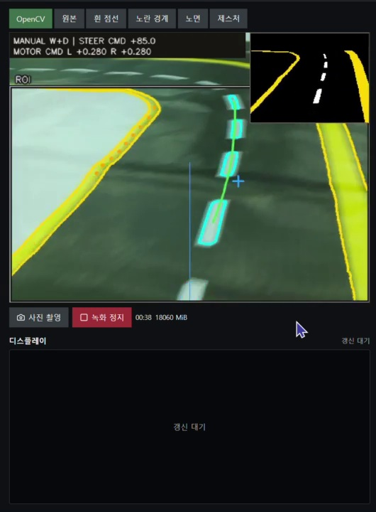
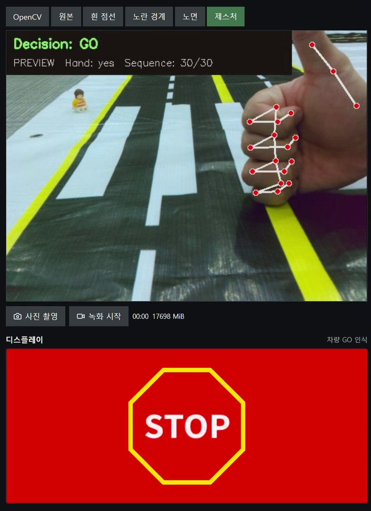
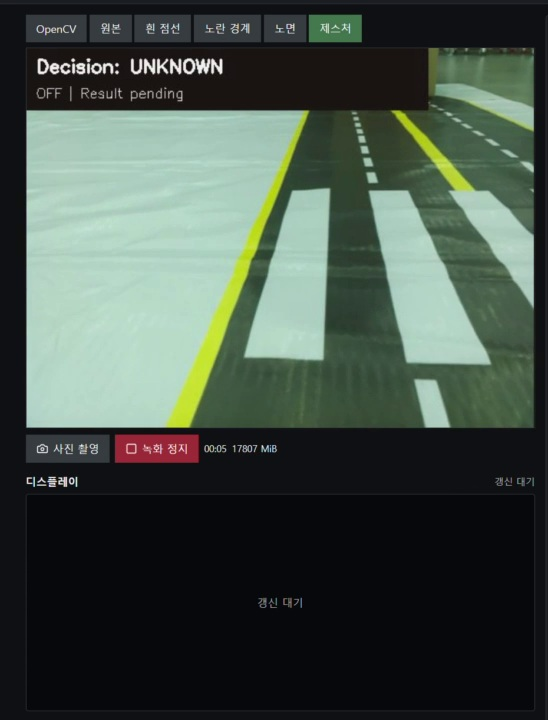

# 사진으로 보는 기술 설명

[프로젝트 README](../README.md) · [제스처 코드](../Gesture/README.md) · [서보 주행 코드](../Auto%20Driving/With%20Steering/README.md)

이 문서는 저장소의 현재 구현을 설명합니다. 실제 기록 화면은 인식 결과를 보여주며,
모든 조건에서의 정확도나 트랙 완주를 입증하는 자료는 아닙니다.

## 1. 도로를 어떻게 구분하나요?



오른쪽 위 검은 창은 배경을 걷어낸 **통합 마스크**입니다. 노란색은 경계, 흰색은 점선 후보입니다.
큰 영상의 청록색 윤곽은 점선 후보, 초록선은 선택된 경로, 파란 세로선은 기준 위치입니다.
후보가 검출되었다는 것과 주행할 경로가 확정되었다는 것은 서로 다른 상태입니다.
이 사진 상단의 `MANUAL W+D`는 수동 명령을 뜻합니다.

| 단계 | 코드가 하는 일 | 왜 필요한가요? |
| --- | --- | --- |
| 크기·ROI 설정 | 분석용 영상을 축소하고 설정된 상단 영역을 제외 | 연산량을 줄이고 도로 밖 배경의 영향을 제한. ROI와 해상도는 설정값 |
| HSV 색 분리 | H·S·V 범위로 노란 픽셀 후보 추출 | 단순 밝기만 보는 것보다 노란 경계와 흰 표시를 구분하기 쉬움 |
| 검은 노면 확인 | 노란 경계로 나뉜 영역의 어두운 픽셀 비율과 경계 접촉 검사 | 교실 바닥·검은 물건을 노면으로 오인하는 경우를 줄임 |
| 흰 표시 추출 | 노면 안의 밝고 채도가 낮은 픽셀과 주변 대비를 함께 검사 | 흰 바탕 전체나 넓게 번진 반사를 점선으로 잡는 경우를 줄임 |
| 형태 검사 | 작은 틈을 닫고 윤곽의 면적·길쭉함·사각형 채움 비율 검사 | 흰 얼룩과 점선 후보를 구분. 원근 때문에 작아진 점선은 이웃 배열도 확인 |
| 경로 선택 | 점선 중심들의 연속성과 노란 경계·노면의 지지 관계 검사 | 옆 차선 점선이나 반사점을 섞어 잘못된 경로를 만드는 경우를 제한 |

**Gaussian Blur의 실제 역할:** 기본 `track_vision.py`는 회색 영상의 주변 밝기를
`GaussianBlur(gray, (0, 0), 7)`로 계산하고 원래 밝기와 차이를 냅니다.
국소 대비를 얻는 용도이며, 전체 파이프라인에 5×5 블러를 먼저 적용하는 방식과는 다릅니다.
반사가 흰 페인트와 비슷한 색·모양이면 이 검사만으로 완전히 구분할 수 없습니다.

구현: [`analyze`, `_road_regions`, `_markings`](../Auto%20Driving/With%20Steering/track_vision.py).

## 2. 중앙 경로와 커브는 어떻게 계산하나요?

흰 점선의 회전 사각형 중심들을 고르고, 영상 높이에 따른 가로 위치를 곡선으로 맞춥니다.
점선의 배열·방향·노면·노란 경계가 서로 맞는지도 확인합니다.
따라서 화면에 보이는 모든 점을 단순 평균내거나, 항상 좌우 노란 선의 중간을 목표로 삼는 구조는 아닙니다.

1. 직선에서 기준 위치와 기준 방향을 설정합니다. 카메라 장착 오차를 기준값에 반영합니다.
2. 선택한 경로의 앞쪽 목표점을 구합니다. 관측 구간에 따라 목표 깊이를 조절할 수 있습니다.
3. 이전 목표와 현재 목표를 섞어 순간 변화를 줄이고, 갑작스러운 경로 점프는 제외합니다.
4. 먼 지점과 가까운 지점의 가로 변화로 경로 방향을 구합니다.
5. 커브에서는 점선 외에도 노란 경계의 방향과 근거리 노면이 실제로 뒷받침하는지 확인합니다.

단순화한 계산 관계는 다음과 같습니다. 실제 코드는 기준 기울기 보정·모드별 제한을 추가합니다.

```text
위치 오차 e = 2 × (정규화한 목표 x − 목표 깊이에서의 기준 x)
방향 오차 h = 경로 방향각 − 기준 방향각
목표 조향 = Kp × e + 방향 게인 × h
최종 조향 = 목표 조향을 좌·우 허용 범위로 제한
```

기본 부호는 음수=왼쪽, 양수=오른쪽입니다. 실제 서보 방향은 하드웨어 확인이 필요합니다.
서보 버전은 위치 오차의 P항과 방향 보정을 함께 쓰므로 **완전한 PID 제어**라고 표현하지 않습니다.
커브가 확인되면 설정한 비율로 출력을 낮추고, 직선 증거가 이어지면 기본 출력으로 돌아갑니다.
PWM 출력 수치는 측정된 실제 이동 속도가 아닙니다. 모터·전압·마찰에 따라 움직임이 달라집니다.

구현: [`LanePath.predict`](../Auto%20Driving/With%20Steering/lane_path.py),
[`wanted_angle`, `update_speed`](../Auto%20Driving/With%20Steering/autonomous.py).

### Canny·Hough는 어디에 쓰나요?

[`hough_vision.py`](../Auto%20Driving/With%20Steering/hough_vision.py)는
색상 마스크 → 블러 → Canny → Hough 선분 → 좌우 그룹 중심 계산을 **오프라인 비교**하는 구현입니다.
ROI와 선택적 Bird's Eye View도 비교할 수 있습니다.
현재 기본 주행 경로는 `track_vision.py`와 `lane_path.py`이므로 두 방식을 같은 것으로 설명하면 안 됩니다.
교재 방식의 선분 중간값과 트랙 중앙 흰 점선의 경로는 목표 의미도 다를 수 있습니다.

## 3. 손동작은 어떻게 GO·STOP이 되나요?



빨간 점과 연결선은 MediaPipe의 손 관절·연결 관계입니다.
`Sequence: 30/30`은 분류에 사용할 손 좌표 프레임이 버퍼에 채워졌다는 뜻입니다.
이 사진은 PREVIEW 모드이며 제스처를 인식했다는 사실만으로 차량이 출발한 것은 아닙니다.

| 단계·기술 | 구현 | 선택한 이유 |
| --- | --- | --- |
| OpenCV | 카메라 BGR 영상을 RGB로 변환하고 결과를 그림 | MediaPipe 입력 형식을 맞추고 관절·문자를 화면에 표시 |
| MediaPipe Hands | 한 손의 21개 지점에서 x·y·z 좌표 추출 | 원본 이미지 대신 손의 구조를 수치로 표현 |
| NumPy 정규화 | 모든 점에서 손목 좌표를 빼고 손목→중지 MCP 길이로 나눔 | 화면 위치와 손 크기 변화의 영향을 줄임. 회전·가림 영향까지 없어지지는 않음 |
| 연속 특징 | 21점×3좌표×30프레임=1,890개 숫자로 연결 | 한 장의 손 모양만이 아니라 최근 프레임의 변화를 비교 |
| KNN | 저장 예시와 유클리드 거리를 계산하고 가까운 3개의 라벨로 다수결 | 별도 대형 분류망을 실행하지 않고 기존 손동작 예시를 재사용 |
| 판정 보완 | 손 검출 비율·거리 임계값·손가락 펼침 검사 | 손 미검출, 예시와 다른 동작, STOP 오인 일부를 unknown으로 처리 |

현재 모델 파일에는 **256개 예시의 특징·라벨**이 저장되어 있습니다.
기본 설정은 30프레임 중 손 검출 비율 60% 이상, 최근접 3개 평균 거리가 30 이내입니다.
STOP은 네 손가락 중 세 개 이상이 펼쳐졌는지 추가 검사합니다.
손바닥 방향 검사도 있지만 기본 `palm_sign="off"`이므로 기본 실행에서 방향 제한이 항상 적용된다고 설명하지 않습니다.

30프레임은 고정된 1초가 아닙니다. 실제 제스처 처리 FPS에 따라 필요한 시간이 달라집니다.
`Dist`는 손과 카메라의 물리적 거리가 아니라 **특징 벡터 사이의 거리**이며, 확률·정확도도 아닙니다.

### 학습 데이터와 실행 중 데이터의 차이

MediaPipe는 미리 학습된 손 검출·좌표 모델이고, KNN은 저장된 손동작 특징과 라벨을 사용합니다.
카메라를 켜 두거나 자율주행을 반복한다고 이 예시들이 자동으로 추가되거나 재학습되지는 않습니다.
이전 수집·학습 스크립트는 보존했지만 일부는 손+자세 특징을 사용하므로 현재 손 전용 모델과 입력을 맞춰야 합니다.
일상 동작·물건을 든 손의 오인 문제는 남아 있으며 정량 정확도는 별도 검증이 필요합니다.

구현: [`GestureRecognizer`](../Gesture/gesture_recognition_module.py),
[`normalize_hand_frame`, `is_open_hand`](../Gesture/hand_utils.py),
[`모델`](../Gesture/models/gesture_knn_model.npz).

## 4. 인식 결과를 화면·차량에 어떻게 연결하나요?

**디스플레이 의미:** GO·STOP은 차량을 향한 요청입니다.
차량 GO에는 보행자에게 멈추라는 **빨간 STOP**, 차량 STOP에는 보행자가 건너라는 **초록 보행 GIF**를 표시합니다.
신호 대상이 달라 글자와 색이 반대로 보일 수 있습니다.

Flask는 영상·결과·설정을 브라우저에 제공하고 조작 요청을 받는 웹 프레임워크입니다.
도로와 손을 인식하는 알고리즘 자체는 OpenCV·MediaPipe·KNN과 각 Python 모듈에 있습니다.

[`worker.py`](../Gesture/worker.py)는 오래된 프레임을 줄 세우지 않고 최신 입력으로 교체합니다.
화면 라벨 유지와 차량 제어용 판정을 분리하고, 0.2초보다 오래된 결과를 제어 근거에서 제외합니다.
이는 화면에 잠시 남은 GO를 새 출발 요청으로 오인하는 경우를 막기 위한 구조입니다.
입력 카메라·도로 처리·제스처 처리·미리보기 FPS는 서로 다르며 30FPS 설정이 모든 처리의 30FPS를 보장하지 않습니다.

### 횡단보도 연동의 현재 코드



[`crosswalk.py`](../Auto%20Driving/With%20Steering/crosswalk.py)는 흰 줄무늬의 방향·간격·폭과
여러 프레임의 연속성을 확인하고, 관측된 횡단보도 표시를 일반 점선 후보에서 제외합니다.
연동을 켠 경우 [`CrossingGate`](../Auto%20Driving/With%20Steering/interaction.py)는
횡단보도 접근 → 정지·제스처 대기 → 신선한 GO 확인·경로 준비 → 출발 상태로 전환합니다.
현재 게이트의 GO 조건은 새로운 결과 5개 이상·0.5초 이상입니다.

이전 발표 구상인 「GO 후 3초 / STOP 종료 후 5초 / 사람 없으면 3초」가
이 게이트에 모두 구현된 것은 아닙니다. 화면 GIF 표시와 실제 주행 연동도 별도 설정입니다.
사진 속 레고는 시연 소품이며 레고 자동 검출 성공의 증빙으로 쓰지 않습니다.

## 5. 사람 검출·모터·이전 버전은요?

| 기술·구성 | 왜 사용했나요? | 적용 범위 |
| --- | --- | --- |
| YOLOv8n-seg · Ultralytics · PyTorch | 사람 위치뿐 아니라 몸의 윤곽 다각형도 표시 | [`PC 사람 검출`](../Gesture/person_detection.py). COCO person 클래스만 사용하며 Pi 제스처·차량 제어와 개별 보행자를 연결하는 추적기는 아님 |
| GPIO Zero | Motor·AngularServo 추상화로 제어 출력 구성 | [`manual_drive.py`](../Auto%20Driving/With%20Steering/manual_drive.py). DC 모터 채널과 서보 각도 명령 |
| lgpio | Pi의 Linux GPIO에 접근하는 핀 백엔드 | GPIO Zero의 `LGPIOFactory`로 사용. 인식·판단 알고리즘은 아님 |
| 서보 없는 P제어 | 차선 위치 오차를 좌우 DC 모터 출력 차이로 변환 | [`road_drive_p_control.py`](../Auto%20Driving/Without%20Steering/controller/road_drive_p_control.py). 서보 버전과 모터 구성·제어값이 다름 |
| Webots·학습 모델 | 시뮬레이션에서 주행 데이터를 생성하고 모델을 학습·평가 | [`simulation`](../Auto%20Driving/Without%20Steering/simulation). 현재 서보 트랙 코드의 자동 온라인 학습 기능은 아님 |
| CNN 비교 | KNN과 다른 분류기의 결과를 비교 | [`cnn_compare_module.py`](../Gesture/cnn_compare_module.py). 선택적 비교 실험 |

이전 **Webots 데이터 생성·학습 실험**은 [사진과 함께 보는 별도 문서](webots-training.md)에 정리했습니다.
가상 교사 주행, 차선별 데이터 9,000장, 영상→좌우 PWM 릿지 회귀, 실패 사례와 폐루프 평가를 설명합니다.

## 사진·영상 출처

모두 프로젝트 [기술·시연 발표 사이트](https://pedestrian-gesture-deck.pages.dev/showcase#1)의 기존 기록입니다.
README의 이미지는 저장소에도 보관하여 외부 이미지 주소가 바뀌어도 보이도록 했습니다.
긴 영상은 저장소 용량을 늘리지 않도록 원본 링크를 제공합니다.

- [도로 인식 주행 기록](https://pedestrian-gesture-deck.pages.dev/media/driving-03.mp4) · [사용 이미지](https://pedestrian-gesture-deck.pages.dev/media/driving-03.jpg)
- [손동작·디스플레이 시연](https://pedestrian-gesture-deck.pages.dev/media/gesture-present-merged-20261022.mp4) · [사용 이미지](https://pedestrian-gesture-deck.pages.dev/media/gesture-present-merged-20261022.jpg)
- [손·보행자 없는 횡단보도 관측 영상](https://pedestrian-gesture-deck.pages.dev/media/gesture-absent-screen.mp4) · [사용 이미지](https://pedestrian-gesture-deck.pages.dev/media/gesture-absent-screen.jpg)
