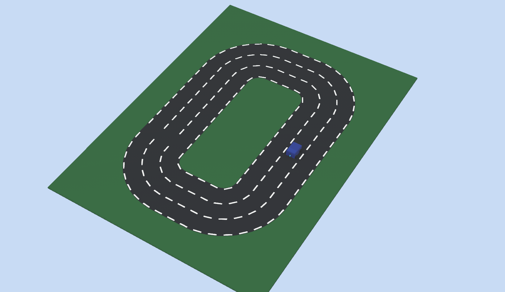
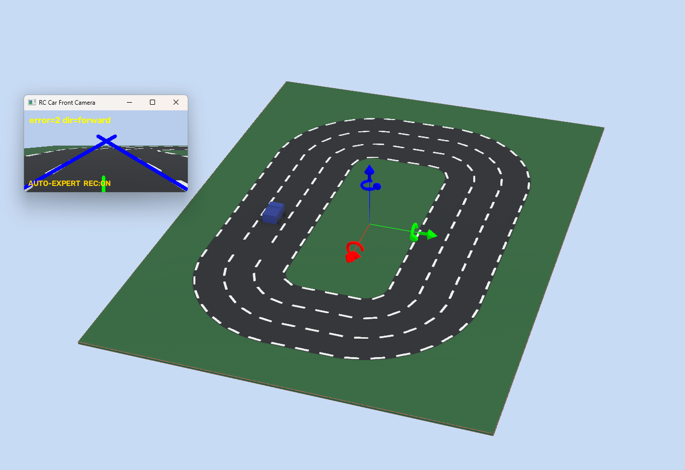
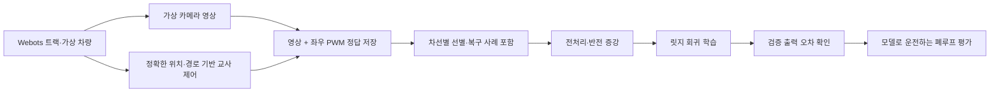

# Webots로 주행 데이터를 만들고 모델을 학습한 과정

[프로젝트](../README.md) · [시뮬레이션 코드·실행 안내](../Auto%20Driving/Without%20Steering/simulation/README.md) · [현재 서보 주행](../Auto%20Driving/With%20Steering/README.md)

실제 로봇 없이 차선·커브 조건을 반복 실험하기 위해 Webots에 차량과 트랙을 만들었습니다.
가상 카메라 영상에 교사 제어기의 좌우 모터 출력을 정답으로 붙여 데이터를 수집하고,
**영상으로부터 좌우 PWM을 예측하는 지도학습·모방학습**을 진행했습니다.
현재 서보 차량의 기본 주행은 OpenCV·P제어이며 이 모델을 기본 제어기로 사용하지 않습니다.

## 가상 환경과 데이터 수집 화면

직선과 둥근 코너가 있는 3차선 트랙입니다. 차선마다 코너 반경이 달라 서로 다른 회전 조건을 수집할 수 있습니다.
차량은 4륜 모델이며 앞바퀴 조향 서보 대신 좌우 바퀴 출력 차이로 회전합니다.

작은 창은 가상 카메라의 1인칭 영상과 OpenCV 인식 결과입니다.
`AUTO-EXPERT REC:ON`은 **교사 제어기로 이동하면서 데이터 기록이 켜진 상태**를 뜻합니다.
`error=2 dir=forward`는 해당 순간의 영상 차선 오차·판정이며 학습 모델의 정확도 수치가 아닙니다.
두 장은 2026-11-03 기존 월드를 다시 열어 사용자가 캡처한 설명용 화면입니다.
아래 2026-09-01 학습·평가 기록과는 구분합니다.

## 전체 흐름

교사는 시뮬레이터의 정확한 차량 위치와 목표 경로를 사용합니다.
OpenCV의 잘못된 판정을 그대로 정답으로 삼지 않고, 영상·인식 결과·교사 출력을 함께 기록하는 이유입니다.
강화학습처럼 보상으로 정책을 갱신하거나, 켜 둔 동안 모델이 자동 재학습되는 방식은 아닙니다.

## 무엇을 사용했고 왜 사용했나요?

| 기술·구현 | 역할 | 사용한 이유 |
| --- | --- | --- |
| Webots | 트랙·물리 차량·카메라·바퀴 모터 시뮬레이션 | 실물 없이 반복 수집하고 정확한 위치·방향 오차 측정 |
| Python·Webots controller API | 카메라와 가상 모터 연결, 제어 모드 전환 | 교사·영상·학습 제어를 같은 환경에서 비교 |
| OpenCV | 영상 저장, 회색조·노면 극성 정규화, 축소·증강 | 입력을 단순화하고 노면 색 변화에 대응 |
| NumPy | 특징 배열, 표준화, 선형 방정식 풀이 | 작은 릿지 회귀 모델을 직접 학습·추론 |
| CSV·JSON·NPZ | 정답·출처, 통계·평가, 모델 저장 | 영상의 수집 실행과 정답을 추적 |
| 교사 경로 제어기 | 정확한 가상 위치·방향에서 좌우 PWM 정답 생성 | 안정적인 주행 예시와 복구 명령 확보 |

주행 모델 학습에는 CNN·YOLO·MediaPipe·KNN을 사용하지 않았습니다.
제스처 KNN, PC 사람 검출 YOLO와는 별도 실험입니다.

## 어떤 데이터를 저장했나요?

[`DatasetRecorder`](../Auto%20Driving/Without%20Steering/simulation/controllers/rc_car_controller/dataset_recorder.py)는
기본 5개 제어 프레임마다 이미지와 CSV 한 행을 함께 저장합니다.
제어 간격 32ms 기준 약 160ms마다 한 샘플이며 실제 시간 기준 수집률은 시뮬레이션 속도에 따라 달라집니다.

| 구분 | 주요 저장값 |
| --- | --- |
| 영상·식별 | 320×240 이미지, 샘플 ID, 시뮬레이션 시각 |
| 정답·명령 | 좌우 PWM, 교사 좌우 PWM, 제어 모드·명령 이유 |
| 트랙 조건 | 목표 차선, 코너 반경·곡률 |
| 인식·위치 | 차선 검출 상태·오차, 차량 위치·방향, 경로 횡방향 오차(CTE), 방향 오차 |
| 실행 정보 | 트랙 이름, 카메라 크기, 수집 간격을 적은 JSON |

원시 실행은 `simulation/dataset/runs/run_날짜_시간/` 아래 `images/`, `driving.csv`, `run_metadata.json`으로 기록합니다.
원시 실행 폴더는 Git 제외 대상입니다. GitHub에는 **선별한 `dataset_v2`의 9,000장과 manifest·summary**가 보존되어 있습니다.
저장소만 새로 받아도 선별 데이터의 주행 모델 재학습은 가능하지만,
원시 실패 실행을 쓰는 데이터 재선별·주행 가능성 분류기 재학습·일부 평가 재실행에는 별도 원시 실행 백업이 필요합니다.

### 실제 학습 이미지와 PWM 정답

| 직선 예시 | 커브 예시 |
| --- | --- |
|  |  |
| `lane1_00000` · 왼쪽 0.3400 / 오른쪽 0.3400 | `lane2_00204` · 왼쪽 0.4700 / 오른쪽 0.3500 |

원본 이미지를 그대로 연결했습니다. 정답 수치는
[`manifest.csv`](../Auto%20Driving/Without%20Steering/simulation/dataset_v2/manifest.csv)의 해당 행에서 확인할 수 있습니다.
PWM은 출력 비율이며 실제 차량 속도(m/s)가 아닙니다.

## 데이터 선별과 학습

[`summary.json`](../Auto%20Driving/Without%20Steering/simulation/dataset_v2/summary.json)과
[`steering_v2_metrics.json`](../Auto%20Driving/Without%20Steering/simulation/models/steering_v2_metrics.json) 기준입니다.

| 항목 | 기록된 구성 |
| --- | --- |
| 수집 실행 출처 | 17개 run |
| 차선별 선별 | 안쪽·가운데·바깥 각각 3,000장, 총 9,000장 |
| 정답 출처 | 교사 명령 8,500장 + 교사 기준 복구 정답 500장 |
| 원본 분할 | 차선별 무작위 분할, 학습 7,200장 / 검증 1,800장 |
| 증강 후 | 학습 28,800개 / 검증 7,200개 |
| 입력 특징 | 회색조 32×18 = 576개 픽셀 값 |
| 모델 | L2 규제 선형 회귀(릿지 회귀), 규제값 3.0 |
| 출력 | 왼쪽·오른쪽 PWM 2개 |

1. **선별:** 차선 검출 상태·위치·방향·조향 변화 등을 검사하고 차선별 수량을 맞춥니다. 복구 사례에는 교사 기준 PWM을 정답으로 사용합니다.
2. **전처리:** 세로 55~229행을 회색조로 바꾸고, 아래쪽 중앙 밝기의 중앙값이 높으면 명암을 뒤집어 ‘어두운 노면·밝은 표시’로 맞춥니다.
3. **축소:** 32×18 픽셀 값을 0~1로 만들고 학습 데이터 평균·표준편차로 표준화합니다.
4. **증강:** 원본·좌우 반전·노면 반전·둘을 적용한 영상으로 늘립니다. 좌우 반전에서는 PWM 정답도 바꿉니다. 노면 반전은 흰 노면·어두운 표시를 근사한 합성 변환입니다.
5. **학습:** `영상 특징 × 가중치 + 절편 → 좌우 PWM` 관계를 NumPy로 구하고 전처리·출력 제한값과 함께 NPZ에 저장합니다.

여기서 **밝기의 중앙값(median)**은 노면 반전 여부를 고르는 값입니다.
차량이 따라갈 **차선 중앙 위치**를 계산한다는 의미와 다릅니다.

## 평가와 개선 기록

오프라인 검증은 교사의 PWM과 예측 PWM 차이를 보고,
폐루프 평가는 예측 출력으로 가상 차량을 움직였을 때 경로를 유지하는지 봅니다.
작은 예측 오차도 주행에서는 누적될 수 있어 두 평가를 구분했습니다.

| 저장된 결과 | 수치·관찰 | 해석 |
| --- | --- | --- |
| v1 점선 직사각형 트랙 | 평균 CTE 0.6346m, 820개 중 708개가 가운데 차선 밖 | 바뀐 점선·코너에 일반화하지 못한 실패 기록 |
| v2 오프라인 검증 | 좌·우 PWM MAE 각각 약 0.02955, 좌우 차이 MAE 약 0.04400 | 유사한 분포의 출력 재현 오차 |
| 최종 일반 노면 실행 | 127.52초, 평균 CTE 0.04073m, 최대 0.09819m, 보고서 pass | 해당 시뮬레이션 실행의 결과 |
| 최종 반전 노면 실행 | 124.48초, 평균 CTE 0.04790m, 최대 0.10827m, 보고서 pass | 반전 노면 조건의 해당 실행 결과 |

근거: [v1 실패](../Auto%20Driving/Without%20Steering/simulation/models/steering_v1_test_rectangle_dashed_metrics.json),
[v2 검증](../Auto%20Driving/Without%20Steering/simulation/models/steering_v2_metrics.json),
[최종 폐루프 보고서](../Auto%20Driving/Without%20Steering/simulation/reports/closed_loop_final_color_polarity_eval.json).

최종 폐루프 결과는 보고서의 `steering_v2+vision_trim` 구성입니다.
**영상 오차 기반 보정과 주행 가능성 판정**을 함께 사용했으므로 순수 모델 단독 성능으로 표현하지 않습니다.
초기 실패에서 차선별 데이터 균형·복구 예시·노면 증강·영상 보정으로 확장한 과정이 핵심입니다.

### 주행 가능성 분류기

`driveability_v1`은 정상 주행과 차선 상실·경로 이탈 영상을 구분하는 별도 경량 모델입니다.
양성·음성을 각각 2,500장 선택하고 Gaussian Blur·Canny 윤곽을 32×18로 줄인 특징을 사용했습니다.
저장된 검증 정확도는 95.95%이며, **위험 사례를 주행 가능으로 판정한 FP 154건**도 있습니다.
이는 사람·장애물·실제 도로 안전성의 검증 결과가 아닙니다.
근거: [학습 코드](../Auto%20Driving/Without%20Steering/simulation/training/train_driveability.py),
[검증 기록](../Auto%20Driving/Without%20Steering/simulation/models/driveability_v1_metrics.json).

### 적용 범위와 한계

연속 주행의 비슷한 프레임을 차선별 무작위 분할했으므로 같은 실행의 인접 장면이 학습·검증 양쪽에 들어갈 수 있습니다.
새 환경 일반화는 run·트랙 단위 분리 평가가 추가로 필요합니다.
보고서 pass는 해당 스크립트의 경로 이탈·연속 차선 미검출 기준이며 실제 로봇 완주나 충돌 안전성을 뜻하지 않습니다.
실제 카메라의 반사·주름·노출, 모터 편차·조향 구조가 달라 현재 서보 차량에 그대로 적용하지 않습니다.

## 코드와 기록 찾아보기

| 단계 | 파일 |
| --- | --- |
| 트랙·차량 | [`worlds/`](../Auto%20Driving/Without%20Steering/simulation/worlds), [`BlueRCCar.proto`](../Auto%20Driving/Without%20Steering/simulation/protos/BlueRCCar.proto) |
| 교사·가상 제어 | [`oval_track_expert.py`](../Auto%20Driving/Without%20Steering/simulation/controllers/oval_track_expert.py), [`rc_car_controller.py`](../Auto%20Driving/Without%20Steering/simulation/controllers/rc_car_controller/rc_car_controller.py) |
| 수집·선별 | [`dataset_recorder.py`](../Auto%20Driving/Without%20Steering/simulation/controllers/rc_car_controller/dataset_recorder.py), [`build_dataset_v2.py`](../Auto%20Driving/Without%20Steering/simulation/training/build_dataset_v2.py) |
| 전처리·학습 | [`vision_preprocessing.py`](../Auto%20Driving/Without%20Steering/simulation/controllers/vision_preprocessing.py), [`train_steering_v2.py`](../Auto%20Driving/Without%20Steering/simulation/training/train_steering_v2.py) |
| 추론·보정 | [`learned_steering.py`](../Auto%20Driving/Without%20Steering/simulation/controllers/learned_steering.py), [`learned_control.py`](../Auto%20Driving/Without%20Steering/simulation/controllers/learned_control.py) |
| 평가·출처 | [`evaluate_drive_run.py`](../Auto%20Driving/Without%20Steering/simulation/training/evaluate_drive_run.py), [`reports/`](../Auto%20Driving/Without%20Steering/simulation/reports), [`과거 인계 기록`](../Auto%20Driving/Without%20Steering/simulation/HANDOFF.md) |

이미지 출처: 사용자 캡처 `스크린샷 2026-11-03 222332.png`, `스크린샷 2026-11-03 222415.png`를 변경 없이 복사했습니다.
